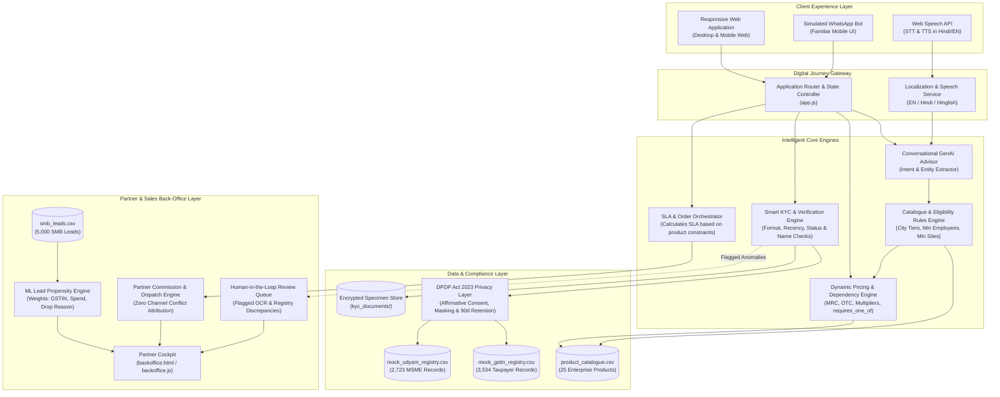

# Solution Architecture — Project Udyam Digital
**Bharti Airtel / Accel Business — Enterprise Track A (Airtel SYNC 2026)**

---

## 1. End-to-End System Architecture



---

## 2. Onboarding & Verification Sequence Flow

```mermaid
sequenceDiagram
    autonumber
    actor Customer as MSME Owner
    participant Web as Web / WhatsApp UI
    participant Adv as GenAI Advisor
    participant Rules as Catalog Rules Engine
    participant KYC as Smart KYC Engine
    participant Reg as Mock Registry (GST/Udyam)
    participant OCR as Document OCR Engine
    participant BackOffice as Partner Back-Office
    participant Field as Field Partner / Engineer

    Customer->>Web: Accesses Udyam Digital (Web or WhatsApp)
    Customer->>Adv: "Jaipur me 5 logo ka clinic hai, tez internet aur data security chahiye"
    Adv->>Rules: Query eligible products (City Tier 2, Emps: 5, Segment: Prof)
    Rules-->>Adv: Matched [P02 Biz Fibre 300, P16 Cloud Email, P20 Endpoint Security]
    Adv-->>Customer: Plain-language recommendation with transparent monthly price

    Customer->>Web: Adjusts quantities and selects add-ons
    Web->>Rules: Validate 'requires_one_of' dependencies and compute MRC/OTC
    Rules-->>Web: Real-time quote generated: ₹2,423/mo (0 hidden charges)

    Customer->>Web: Grants DPDP Act 2023 affirmative consent
    alt Method A: Instant Registry Prefill
        Customer->>KYC: Enters GSTIN / Udyam Number
        KYC->>Reg: Query mock registry database
        Reg-->>KYC: Returns Legal Name, Trade Name, Status (Active/Cancelled)
    else Method B: Document Upload & OCR
        Customer->>KYC: Uploads Electricity Bill & Registration Certificate
        KYC->>OCR: Extract Legal Name, GSTIN, Bill Date, Signatory Name
        OCR-->>KYC: Check bill date <= 90 days from 2026-07-15 & reconcile names
    end

    alt Instant Verification Pass (e.g. K02, K03, K12)
        KYC-->>Web: Instant Verification Passed (DPDP Audit Token Generated)
        Web->>Customer: Order AB-2026-XXXX confirmed with 5-day installation SLA
        Web->>Field: Dispatch installation work order to Jaipur Partner
    else Verification Anomaly (e.g. K01 Cancelled, K11 Expired Bill)
        KYC-->>BackOffice: Route to Human-in-the-Loop Exception Queue
        BackOffice-->>Field: Assign partner for assisted on-site document refresh
        Web-->>Customer: Provisional order created; partner assigned for doorstep verification
    end
```

---

## 3. Core Component Specifications

### 3.1 Client Experience Layer
- **Responsive Mobile Web Application (`index.html`)**: Single-page application optimized for mobile viewports (where 78% of MSME owners interact) and desktop.
- **Simulated WhatsApp Interface (`wa-modal`)**: Lightweight simulation replicating WhatsApp's interaction model, addressing the hackathon stretch goal for a familiar conversational front-end.
- **Voice Controller (`app.js`)**: Leverages browser-native `SpeechRecognition` (Hindi and English) and `SpeechSynthesis` for audio dialogue.

### 3.2 Intelligent Processing Layer
- **Conversational GenAI Advisor**: Multi-intent and entity extraction parsing segment keywords, employee numbers, location tiers, and operational requirements. Grounded strictly in `product_catalogue.csv` rules to prevent hallucinated pricing.
- **Dynamic Bundle Builder & Quote Engine**: Real-time dependency resolver enforcing `requires_one_of` rules (preventing standalone purchase of failover or firewalls without base broadband), calculating transparent monthly recurring charges (MRC) and one-time setup fees (OTC).
- **Smart KYC & Verification Engine**:
  - Validates GSTIN checksum and 15-character synthetic format (accepting `X` as 4th PAN character).
  - Validates address proof recency (must be within 90 days of anchor date `2026-07-15`).
  - Reconciles authorized signatory ID names against registration legal/trade records.
- **SLA & Order Orchestrator**: Dynamically computes realistic installation delivery dates based on the maximum `typical_install_days` constraint across the chosen bundle items.

### 3.3 Partner & Sales Back-Office Layer (`backoffice.html`)
- **ML Lead Propensity Engine**: Analyzes 5,000 synthetic leads from `smb_leads.csv`, calculating a 0–99 conversion propensity score based on segment conversion benchmarks, GSTIN status, monthly spend, and process-friction drop reasons ("Owner had no time for visit", "Quote too complex").
- **Human-in-the-Loop Exception Queue**: Displays flagged document mismatches for partner intervention, preventing unnecessary customer drop-off.
- **Partner Commission Attribution**: Transparently tracks local partner earnings (10% first-year contract pool) ensuring alignment between field executives and digital acquisition.

---

## 4. Security & DPDP Act 2023 Compliance Architecture

| Architectural Layer | Implementation | DPDP Act 2023 Section |
| :--- | :--- | :--- |
| **Notice & Consent** | Granular, non-bundled affirmative consent card before any lookup or upload. | Section 6 (Consent) |
| **Purpose Limitation** | Identifiers queried strictly for Accel Business service provisioning. | Section 5 (Notice) |
| **Data Minimisation** | Extracts only statutory registration, address, and signatory fields. | Section 6 (Minimisation) |
| **Data Masking** | Masked display in UI and logs (e.g. `08YKZXS****1Z0`, masked Aadhaar/PAN). | Section 8 (Security Safeguards) |
| **Storage Limitation** | Raw KYC document images scheduled for operational purge after 90 days. | Section 8 (Retention) |
| **Audit Logging** | Cryptographic SHA-256 tokens retained for statutory verification audit trails. | Section 8 (Accountability) |

---

## 5. Mock vs Production Environment Mapping

| Component | Demo Prototype Implementation | Production Enterprise Architecture |
| :--- | :--- | :--- |
| **Product Catalogue** | Local `product_catalogue.csv` with in-memory rules engine. | Enterprise Product Catalog / CPQ Microservice (REST/gRPC). |
| **GSTIN Lookup** | Mock search against 3,534 records in `mock_gstin_registry.csv`. | Live GSTN API via approved GSP (GST Suvidha Provider). |
| **Udyam Lookup** | Mock search against 2,723 records in `mock_udyam_registry.csv`. | Ministry of MSME National Udyam Verification API. |
| **Document OCR** | RapidOCR ONNX engine / client-side parsing with rule checks. | Cloud Vision OCR / Azure Document Intelligence pipeline. |
| **Signatory Check** | Client-side name matching against signatory ID specimen. | DigiLocker B2B API & Aadhaar e-Sign / PAN NSDL API. |
| **Order Tracking** | Dynamic browser-simulated SLA engine with live timer. | Enterprise Order Orchestration System (Camunda / Temporal). |
